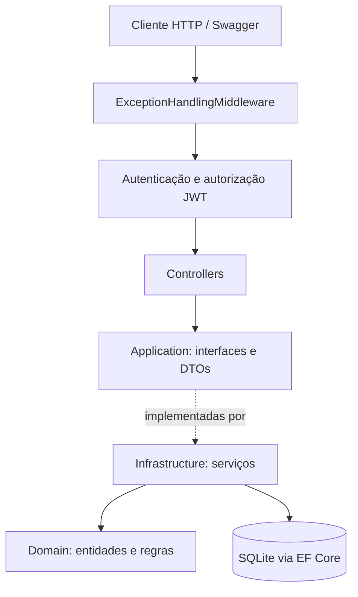
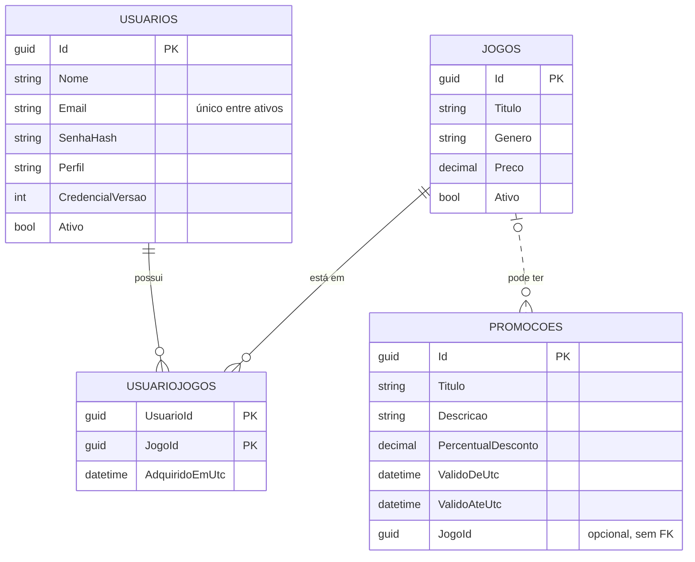

# FIAP Cloud Games (FCG) — API

API REST de uma plataforma de jogos digitais: cadastro e autenticação de usuários, catálogo de jogos, biblioteca pessoal e promoções, com controle de acesso por perfil.


**Autor e mantenedor:** Gabriel Lamas — [github.com/LMXSS](https://github.com/LMXSS)

## Sumário

- [Sobre o projeto](#sobre-o-projeto)
- [Funcionalidades](#funcionalidades)
- [Tecnologias](#tecnologias)
- [Arquitetura](#arquitetura)
- [Modelo de dados](#modelo-de-dados)
- [Como executar](#como-executar)
- [Configuração](#configuração)
- [Referência da API](#referência-da-api)
- [Exemplo de uso](#exemplo-de-uso)
- [Regras de negócio](#regras-de-negócio)
- [Segurança](#segurança)
- [Observabilidade](#observabilidade)
- [Testes](#testes)
- [Migrations](#migrations)
- [Limitações conhecidas](#limitações-conhecidas)
- [Origem do projeto](#origem-do-projeto)

## Sobre o projeto

O FCG é um monólito em ASP.NET Core organizado em camadas inspiradas em DDD. Ele cobre o ciclo principal de uma loja de jogos: o usuário se cadastra, navega pelo catálogo, adquire jogos para a própria biblioteca e consulta promoções vigentes. Administradores gerenciam o catálogo, as promoções e as contas de usuários.

## Funcionalidades

**Usuário**

- Cadastro e login com token JWT
- Consulta e edição do próprio perfil
- Troca de senha com confirmação da senha atual
- Biblioteca pessoal: adicionar, listar e remover jogos

**Administrador**

- Criar, editar, inativar e reativar jogos
- Criar promoções, gerais ou vinculadas a um jogo
- Listar e editar usuários, alterar perfis, inativar e reativar contas

**Plataforma**

- Invalidação imediata de tokens ao mudar credenciais ou perfil
- Exclusão lógica de usuários e jogos
- Tratamento global de erros com resposta JSON padronizada
- Migrations aplicadas automaticamente na inicialização
- Logs estruturados, traces e métricas com New Relic e OpenTelemetry

## Tecnologias

| Área | Tecnologia |
|------|------------|
| Plataforma | .NET 8, ASP.NET Core Web API |
| Persistência | Entity Framework Core 8, SQLite |
| Autenticação | JWT Bearer (HS256), hash de senha com BCrypt |
| Documentação | Swagger / OpenAPI (Swashbuckle) |
| Logs | Serilog, com envio opcional ao New Relic Logs |
| Traces e métricas | OpenTelemetry com exportação OTLP |
| Testes | xUnit, FluentAssertions, SQLite nos testes de serviço |

## Arquitetura



```text
.
├── FCG.sln
├── src/FCG
│   ├── Controllers/       # Endpoints HTTP
│   ├── Application/       # Interfaces de serviço e DTOs
│   ├── Domain/            # Entidades, perfis e validação de credenciais
│   ├── Infrastructure/    # EF Core, migrations, JWT, serviços e seed
│   ├── Middleware/        # Tratamento global de erros
│   ├── Extensions/        # Helpers de claims do usuário autenticado
│   └── Program.cs         # Composição e pipeline da aplicação
└── tests/FCG.Tests
    ├── Behaviors/         # Cenários BDD (Dado / Quando / Então)
    ├── Domain/            # Testes de entidades e regras
    ├── Security/          # Geração de token
    ├── Services/          # Serviços com banco SQLite
    └── Support/           # Infraestrutura de testes
```

## Modelo de dados



## Como executar

**Pré-requisito:** [.NET 8 SDK](https://dotnet.microsoft.com/download/dotnet/8.0).

```bash
git clone https://github.com/LMXSS/TC1.git
cd TC1
dotnet restore
cd src/FCG
dotnet run
```

Com o perfil padrão, a API sobe em ambiente `Development`:

| Recurso | Endereço |
|---------|----------|
| Swagger UI | https://localhost:49766/swagger |
| HTTP | http://localhost:49767 |
| Health check | `GET /health` |

Se o navegador não confiar no certificado local, execute `dotnet dev-certs https --trust`.

Na primeira execução, a aplicação cria o banco `src/FCG/fcg.db` e aplica as migrations.

### Administrador de desenvolvimento

Em `Development`, o seed cria um administrador, caso o e-mail ainda não exista:

| Campo | Valor |
|-------|-------|
| E-mail | `admin@fcg.local` |
| Senha | `Admin@123x` |

Essas credenciais são apenas para uso local. O seed não roda em outros ambientes.

## Configuração

As configurações ficam em `src/FCG/appsettings.json` e `appsettings.Development.json`. Qualquer chave pode ser sobrescrita por variável de ambiente, usando `__` como separador.

| Chave | Variável de ambiente | Descrição |
|-------|----------------------|-----------|
| `ConnectionStrings:DefaultConnection` | `ConnectionStrings__DefaultConnection` | Conexão SQLite. Caminhos relativos partem do ContentRoot |
| `Jwt:Key` | `Jwt__Key` | Chave de assinatura, com no mínimo 32 caracteres |
| `Jwt:Issuer` / `Jwt:Audience` | `Jwt__Issuer` / `Jwt__Audience` | Emissor e audiência do token |
| `Jwt:ExpiresMinutes` | `Jwt__ExpiresMinutes` | Validade do token (padrão 120, mínimo 5) |
| `Seed:AdminEmail` / `Seed:AdminPassword` | `Seed__AdminEmail` / `Seed__AdminPassword` | Administrador criado em `Development` |
| `NewRelic:LicenseKey` ou `NewRelic:InsertKey` | `NewRelic__LicenseKey` ou `NewRelic__InsertKey` | Chave para envio de logs |
| `Observability:Enabled` | `Observability__Enabled` | Liga ou desliga o OpenTelemetry |
| `Observability:OtlpEndpoint` | `Observability__OtlpEndpoint` | Endpoint OTLP |
| `Observability:OtlpHeaders` | `Observability__OtlpHeaders` | Cabeçalhos OTLP, como `api-key=<SUA_CHAVE>` |

> **Importante:** o `Jwt:Key` versionado serve apenas para desenvolvimento local. Em qualquer ambiente exposto, defina uma chave própria por variável de ambiente ou cofre de segredos.

## Referência da API

Rotas protegidas exigem o cabeçalho `Authorization: Bearer {token}`. No Swagger, use o botão **Authorize**.

### Autenticação

| Método | Rota | Acesso | Descrição |
|--------|------|--------|-----------|
| POST | `/api/auth/register` | Público | Cria uma conta com perfil `Usuario` e retorna o token |
| POST | `/api/auth/login` | Público | Autentica e retorna o token |

### Minha conta

| Método | Rota | Acesso | Descrição |
|--------|------|--------|-----------|
| GET | `/api/users/me` | Autenticado | Dados do usuário logado |
| PUT | `/api/users/me` | Autenticado | Atualiza nome e e-mail |
| PUT | `/api/users/me/password` | Autenticado | Altera a senha |
| GET | `/api/users/me/biblioteca` | Autenticado | Lista a biblioteca |
| POST | `/api/users/me/biblioteca/games/{gameId}` | Autenticado | Adiciona um jogo à biblioteca |
| DELETE | `/api/users/me/biblioteca/games/{gameId}` | Autenticado | Remove um jogo da biblioteca |

### Jogos

| Método | Rota | Acesso | Descrição |
|--------|------|--------|-----------|
| GET | `/api/games` | Público | Lista os jogos ativos |
| POST | `/api/games` | Administrador | Cria um jogo |
| PUT | `/api/games/{id}` | Administrador | Atualiza um jogo |
| DELETE | `/api/games/{id}` | Administrador | Inativa um jogo |
| POST | `/api/games/{id}/reactivate` | Administrador | Reativa um jogo |

### Promoções

| Método | Rota | Acesso | Descrição |
|--------|------|--------|-----------|
| GET | `/api/promocoes` | Público | Lista as promoções vigentes |
| POST | `/api/admin/promocoes` | Administrador | Cria uma promoção |

### Administração de usuários

| Método | Rota | Acesso | Descrição |
|--------|------|--------|-----------|
| GET | `/api/admin/users` | Administrador | Lista os usuários ativos |
| PUT | `/api/admin/users/{userId}` | Administrador | Atualiza nome e e-mail |
| PATCH | `/api/admin/users/{userId}/role` | Administrador | Altera o perfil |
| DELETE | `/api/admin/users/{userId}` | Administrador | Inativa a conta |
| POST | `/api/admin/users/{userId}/reactivate` | Administrador | Reativa a conta |

### Saúde

| Método | Rota | Acesso | Descrição |
|--------|------|--------|-----------|
| GET | `/health` | Público | Retorna `{"status":"ok"}` |

### Códigos de resposta

| Código | Quando ocorre |
|--------|---------------|
| 200 | Operação concluída |
| 400 | Dados inválidos ou regra de negócio violada |
| 401 | Token ausente, inválido ou expirado, ou credenciais incorretas |
| 403 | Usuário autenticado sem o perfil necessário |
| 404 | Recurso não encontrado |
| 500 | Erro inesperado |

Erros tratados pela aplicação seguem este formato:

```json
{
  "error": "E-mail ja cadastrado.",
  "traceId": "0HNPQ08SGM7S0:00000001"
}
```

Respostas 401 e 403 geradas pelo pipeline de autorização, como em uma requisição sem token, vêm sem corpo.

## Exemplo de uso

Os comandos abaixo usam a porta HTTP do perfil padrão.

**1. Criar uma conta**

```bash
curl -X POST http://localhost:49767/api/auth/register \
  -H "Content-Type: application/json" \
  -d '{"name":"Maria","email":"maria@email.com","password":"Senha@123"}'
```

```json
{
  "token": "eyJhbGciOi...",
  "expiresAtUtc": "2026-01-01T02:00:00Z",
  "userId": "16d92d8f-a1cc-42ae-a059-31d40704cdb1",
  "name": "Maria",
  "email": "maria@email.com",
  "role": "Usuario"
}
```

**2. Entrar como administrador e cadastrar um jogo**

```bash
curl -X POST http://localhost:49767/api/auth/login \
  -H "Content-Type: application/json" \
  -d '{"email":"admin@fcg.local","password":"Admin@123x"}'

curl -X POST http://localhost:49767/api/games \
  -H "Authorization: Bearer <TOKEN_ADMIN>" \
  -H "Content-Type: application/json" \
  -d '{"titulo":"Jogo Exemplo","genero":"Aventura","preco":59.90}'
```

**3. Adicionar o jogo à biblioteca**

```bash
curl -X POST http://localhost:49767/api/users/me/biblioteca/games/<ID_DO_JOGO> \
  -H "Authorization: Bearer <TOKEN_USUARIO>"

curl http://localhost:49767/api/users/me/biblioteca \
  -H "Authorization: Bearer <TOKEN_USUARIO>"
```

**4. Criar uma promoção**

```bash
curl -X POST http://localhost:49767/api/admin/promocoes \
  -H "Authorization: Bearer <TOKEN_ADMIN>" \
  -H "Content-Type: application/json" \
  -d '{"titulo":"Semana do Jogo","descricao":"Desconto especial","percentualDesconto":25,"dataPromoInicio":"2026-01-01T00:00:00Z","dataPromoFim":"2030-01-01T00:00:00Z","gameId":"<ID_DO_JOGO>"}'
```

O campo `gameId` é opcional.

## Regras de negócio

**Usuários e credenciais**

- O e-mail é normalizado (sem espaços nas pontas e em minúsculas) e precisa ter formato válido.
- Um e-mail não pode se repetir entre contas ativas.
- A senha precisa de pelo menos 8 caracteres, com letra, número e caractere especial.
- Todo cadastro público recebe o perfil `Usuario`. Somente um administrador pode promover uma conta.
- Uma conta inativa não consegue fazer login, e os tokens já emitidos para ela deixam de valer.

**Jogos e biblioteca**

- O título é obrigatório e o preço não pode ser negativo.
- Jogos inativos saem do catálogo e não podem ser adquiridos.
- Um jogo inativado continua aparecendo na biblioteca de quem já o adquiriu.
- O mesmo jogo não pode ser adicionado duas vezes à biblioteca.

**Promoções**

- O título é obrigatório e o desconto deve estar entre 0 e 100.
- A data de início deve ser anterior à de fim.
- Quando informado, `gameId` deve apontar para um jogo existente.
- A listagem pública retorna apenas promoções dentro do período de vigência.

## Segurança

- **Senhas:** armazenadas somente como hash BCrypt.
- **Tokens:** assinados com HS256, com validação de emissor, audiência, assinatura e validade.
- **Revogação:** cada usuário tem uma versão de credencial, enviada no token (claim `cred_v`) e conferida no banco a cada requisição autenticada. Ela muda ao trocar senha, e-mail ou perfil e ao inativar a conta, o que invalida os tokens anteriores.
- **Autorização:** rotas administrativas exigem o perfil `Administrador`.
- **Mensagens de erro:** o login responde da mesma forma para e-mail inexistente, senha incorreta e conta inativa.

## Observabilidade

- **Logs:** Serilog escreve no console e envia ao New Relic quando `NewRelic:Enabled` é `true` e há uma chave configurada.
- **Traces:** instrumentação de ASP.NET Core e `HttpClient`.
- **Métricas:** instrumentação de ASP.NET Core, `HttpClient` e runtime do .NET.

Exemplo de configuração por variáveis de ambiente:

```bash
export NewRelic__LicenseKey="<SUA_CHAVE>"
export Observability__OtlpEndpoint="https://otlp.nr-data.net:4317"
export Observability__OtlpHeaders="api-key=<SUA_CHAVE>"
```

## Testes

```bash
dotnet test
```

A suíte tem **92 casos de teste**:

| Pasta | O que cobre |
|-------|-------------|
| `Domain/` | Validação de e-mail e senha, perfis e entidades `Usuario` e `Jogo` |
| `Services/` | Autenticação, perfil, administração, jogos, biblioteca e promoções |
| `Security/` | Geração de token JWT |
| `Behaviors/` | Cenários BDD de cadastro e autenticação, no formato Dado / Quando / Então |

## Migrations

As migrations são aplicadas automaticamente quando a API inicia. Para operá-las manualmente, instale o `dotnet-ef`:

```bash
dotnet tool install --global dotnet-ef

# Aplicar as migrations
dotnet ef database update --project src/FCG

# Criar uma nova migration
dotnet ef migrations add NomeDaMigration --project src/FCG --output-dir Infrastructure/Persistence/Migrations
```

## Limitações conhecidas

- **Promoções não alteram preços:** o desconto é cadastrado e listado, mas não é aplicado ao preço do jogo.
- **Aquisição sem pagamento:** adquirir um jogo apenas o adiciona à biblioteca.
- **Listagens sem paginação:** os endpoints retornam todos os registros.
- **Promoções sem edição:** a API só permite criar e listar promoções.
- **Conflitos retornam 400:** e-mail duplicado, por exemplo, não usa o código 409.
- **Erros de negócio geram log de erro:** validações esperadas aparecem nos logs com nível `Error`.
- **Banco recriável na inicialização:** se o histórico de migrations existir sem a tabela `Usuarios`, a aplicação apaga e recria o banco. Revise esse comportamento antes de usar em produção.
- **SQLite:** adequado para desenvolvimento e demonstração, mas com escrita concorrente limitada.

## Origem do projeto

O FCG nasceu como entrega do **Tech Challenge — Fase 1** da pós-graduação da FIAP, desenvolvido em grupo (Grupo 03) no [repositório original](https://github.com/VHMoschini/TechChallenge_G3). Este repositório é a versão pessoal de Gabriel Lamas, publicada a partir do estado final daquela entrega.
